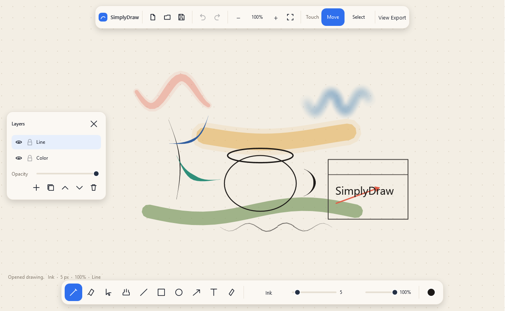

# SimplyDraw

SimplyDraw is a Windows drawing app for pen tablets and a mouse. The page is an infinite vector canvas: lines stay sharp when you zoom, a finger moves the page instead of drawing, and brushes, layers, and a color fan stay out of the way until you need them.



## Download

The current release is **v0.1.1**. Download the setup exe once. It asks GitHub for the latest release, installs SimplyDraw, and replaces that exe the next time you run it. Drawings stay where they are.

**[Download SimplyDraw v0.1.1](https://github.com/HighRyzchs/SimplyDraw/releases/latest)**

| File | Use it on |
| --- | --- |
| `SimplyDrawSetup-win-x64.exe` | Installer for Intel and AMD Windows PCs |
| `SimplyDrawSetup-win-arm64.exe` | Installer for ARM Windows PCs |
| `SimplyDraw-win-x64.exe` | The app by itself, if you do not want the installer |
| `SimplyDraw-win-arm64.exe` | The app by itself for ARM Windows PCs |

The setup installs to `%LocalAppData%\Programs\SimplyDraw` and adds **SimplyDraw** and **Update SimplyDraw** to the Start menu. Update SimplyDraw is the same setup. It closes the drawing app when you confirm, downloads the latest exe from GitHub, and replaces `SimplyDraw.exe`.

The first launch is slower because the exe unpacks itself. Windows SmartScreen may warn that the file is unrecognized because these builds are not code-signed. Choose **More info**, then **Run anyway**, if you trust the build.

To build one yourself, see [Build from source](#build-from-source).

## What you can do

- Draw on an infinite page and zoom from 2% to 6400% without the ink turning soft.
- Use pressure with a pen. A mouse gets a lighter line when you move faster.
- Pick from nine brushes: Ink, Pencil, Marker, Soft brush, Highlighter, Technical, Nib, Spray, and Fountain.
- Change size, opacity, and smoothing without leaving the page.
- Open a color fan, add colors, and fine-tune them on a color wheel.
- Erase through a stroke, or remove a whole mark.
- Box-select or lasso, then move, scale, rotate, duplicate, or delete.
- Keep work on layers you can hide, lock, reorder, and fade.
- Draw lines, rectangles, ellipses, and arrows. Hold Shift for a straight angle or a square.
- Place text and import images.
- Switch the page between warm paper, white, night, blueprint, and kraft, with dot, line, or isometric grid.
- Undo and redo. Save a `.sdraw` file. Export PNG or SVG.
- Autosave to `%AppData%\SimplyDraw` while a drawing is unsaved.

## Pen and touch

| Input | What it does |
| --- | --- |
| Pen | The active tool. Pressure changes brushes that listen to it. |
| One finger, Touch set to **Move** | Pan the page. The finger never draws. |
| One finger, Touch set to **Select** | Box-select or move marks. |
| Two fingers | Pinch to zoom and slide to pan. |
| Mouse left button | The active tool. |
| Mouse right or middle button, or Space | Pan. |
| Mouse wheel | Zoom toward the pointer. |

While the pen is down, touch is ignored so a resting palm does not move the page.

## Shortcuts

The full list is in [docs/shortcuts.md](docs/shortcuts.md) and under **SimplyDraw → Shortcuts** in the app.

| Key | Action |
| --- | --- |
| B E S H | Pen, eraser, select, move page |
| L R O A | Line, rectangle, ellipse, arrow |
| T I | Text, pick color |
| 1–9 | Choose a brush |
| Ctrl+Z / Ctrl+Y | Undo / redo |
| Ctrl+S / Ctrl+O | Save / open |
| Ctrl+E | Export |
| Delete | Remove the selection |

## Build from source

You need the [.NET 8 SDK](https://dotnet.microsoft.com/download/dotnet/8.0) or a newer SDK, and Windows.

```powershell
dotnet test tests/SimplyDraw.Core.Tests/SimplyDraw.Core.Tests.csproj
dotnet run --project src/SimplyDraw.App
```

A self-contained exe:

```powershell
./scripts/publish.ps1 -Runtime win-x64
```

The exe is written to `publish/win-x64/SimplyDraw.exe`. The installer is `./scripts/publish.ps1 -Runtime win-x64 -Target setup`, written to `publish/win-x64/SimplyDrawSetup.exe`.

## Project layout

| Path | What it is |
| --- | --- |
| `src/SimplyDraw.Core` | Drawing model, brushes, geometry, undo, and the `.sdraw` file format. No UI. |
| `src/SimplyDraw.App` | The Windows window, canvas, and pen/touch input. |
| `src/SimplyDraw.Setup` | The installer. It downloads the latest GitHub release and replaces the installed exe. |
| `tests/SimplyDraw.Core.Tests` | Tests for zoom, stroke outlines, erasing, files, and undo. |
| `docs` | How to use the app, how it is built, and how to extend it. |

More detail: [architecture](docs/architecture.md), [adding a brush or tool](docs/extending.md), [file format](docs/file-format.md).

## License

[MIT](LICENSE). The self-contained exe also includes the .NET runtime; see [NOTICE](NOTICE).
