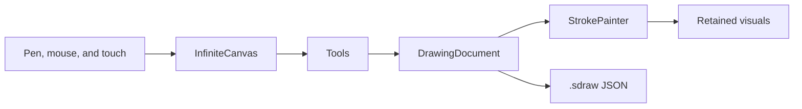

# Architecture

SimplyDraw is split so the drawing rules can be tested without opening a window.

## Core

`SimplyDraw.Core` has no WPF reference.

| Area | Responsibility |
| --- | --- |
| `Model` | `DrawingDocument`, layers, strokes, colors, grids. |
| `Brushes` | Brush presets, paper themes, and the default palette. |
| `Geometry` | Camera zoom, variable-width outlines, hit testing, erasing, smoothing. |
| `Editing` | Undo records. The document is changed first; the record knows how to reverse it. |
| `IO` | `.sdraw` JSON and SVG export. |
| `Demo` | The sample sketch opened from the file menu. |

A freehand stroke stores centerline points with pressure. The ribbon outline is built when painting, so the file stays compact and the width stays correct at any zoom. Pencil and spray store the same centerline and are drawn as stamps.

## App

`InfiniteCanvas` is a `FrameworkElement` with three visuals:

1. A screen-space grid, redrawn when the camera or paper changes.
2. A world-space container. Its transform is `scale(zoom)` plus the pan. Each stroke is its own `DrawingVisual`, so zooming does not rebuild the ink.
3. A screen-space overlay for the selection box, handles, and the brush cursor.

Pen and touch come in as stylus events. A device whose tablet type is touch never starts the drawing tool. One finger pans or selects. Two fingers pinch. A pen down cancels an in-progress touch so a palm does not drag the page. Mouse events that were promoted from a pen are ignored, because the stylus handler already took them.

Tools are small objects owned by the canvas: pen, eraser, select, hand, shapes, text, and the color picker. The window only switches the active id and reads events when the document, the tool, or the view changes.

## Undo

Each edit implements `IEdit` with `Undo` and `Redo`. Adding a stroke, deleting, transforming, erasing, and layer changes are separate records. An eraser gesture that touches several layers is one compound record, so Ctrl+Z restores the whole gesture.

## Coordinates

World coordinates are in device-independent pixels at 100% zoom. `Camera.ZoomAt` keeps the world point under the pointer fixed. Brush minimum distance is about one screen pixel, converted into world units, so a zoomed-in stroke can still carry fine detail.
